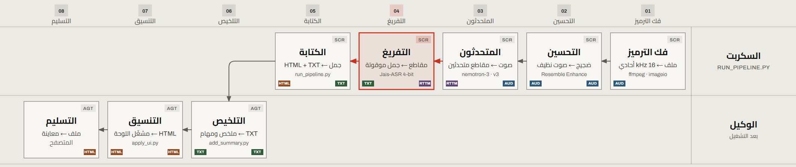

# تفريغ عربي

[English](README.md) · **العربية**

مهارة وكيل تحوّل تسجيلًا صوتيًا عربيًا — رسالة واتساب صوتية، أو اجتماعًا، أو مقابلة —
إلى **صفحة HTML واحدة مكتفية بذاتها**: مشغّل صوت مدمج، وتفريغ ملوّن حسب المتحدث
يتظلّل أثناء التشغيل، ونص ينقلك النقر عليه إلى موضعه في التسجيل، وملخص مكتوب، وقائمة
بنود تنفيذ — بتنسيق «لوحة الرسم الهندسي» مع شريط للحظات المفتاحية على خط الزمن.

مبنية للعربية باللهجة المصرية مع تبديل إلى الإنجليزية (رسائل واتساب الصوتية،
والمذكرات الصوتية، والمكالمات)، وتتعامل مع الفصحى وبقية اللهجات أيضًا.

**كل شيء يعمل على جهازك.** لا سحابة، ولا رفع، ولا حساب، ولا مفتاح — الصوت والنماذج
والصفحة النهائية تبقى على القرص. حركة الشبكة الوحيدة على الإطلاق هي تنزيل النماذج
في المرة الأولى.

```sh
npx skills add yossefismail/arabic-transcribe-skill
```



## ما الذي تحصل عليه

| المخرج | ما هو |
|---|---|
| `<name> - arabic transcript.html` | المخرج الأساسي. الصوت مضمَّن بترميز base64، فيعمل دون اتصال ويمكن إرساله كملف واحد. ألوان للمتحدثين، وتظليل للجملة الجارية، ونقر للانتقال، وبطاقة ملخص بمربعات اختيار تحفظ حالتها. |
| `<name> - arabic transcript.txt` | نسخة نصية احتياطية بعلامات RLM/LRM حتى يظهر العربي والإنجليزي معًا بشكل صحيح في Notepad. |
| `<name> - enhanced audio.m4a` | الصوت بعد التنقية، منفردًا. |

## النموذج والدقة

التفريغ عبر [`IFM/Jais-ASR`](https://huggingface.co/IFM/Jais-ASR) (5.72 مليار معامل،
رخصة Apache-2.0، يُحمَّل بدقة 4 بت). معدلات الخطأ المنشورة على [لوحة التعرّف العربي
المفتوحة](https://github.com/Natural-Language-Processing-Elm/open_universal_arabic_asr_leaderboard)
(الأقل أفضل؛ متوسط ست مجموعات):

| مجموعة الاختبار | WER % | CER % |
|---|---:|---:|
| **المتوسط** | **22.85** | **8.37** |
| Common Voice 18 — فصحى مقروءة | 8.56 | 2.70 |
| MGB-2 — فصحى، أخبار إذاعية | 9.59 | 3.92 |
| MASC نظيف — فصحى، محاضرات | 16.12 | 3.76 |
| MASC مشوّش — فصحى، محاضرات | 25.44 | 7.51 |
| SADA — لهجة سعودية، بث | 30.85 | 14.33 |
| Casablanca — ثماني لهجات، حوار | 46.56 | 18.02 |

هذا المتوسط يتقدّم على بقية النماذج في اللوحة نفسها (Audar ‏23.17،
Speechmatics Melia 1 ‏23.51، ElevenLabs Scribe v2 ‏24.54، Cohere ‏25.87)، لكن ليس
في كل مجموعة منفردة. الحوار متعدد اللهجات هو الحالة الصعبة — احسب خطأً يقارب خمسة
أضعاف الخطأ في فصحى مقروءة نظيفة، ولاحظ أن هذه أرقام bf16 بينما تعمل المهارة بدقة
4 بت.

**التغطية:** الفصحى الحديثة، و19 لهجة (`DZ` جزائرية، `BH` بحرينية، `EG` مصرية،
`AE` إماراتية، `IQ` عراقية، `JO` أردنية، `KW` كويتية، `LB` لبنانية، `LY` ليبية،
`MR` موريتانية، `MA` مغربية، `OM` عُمانية، `PS` فلسطينية، `QA` قطرية، `SA` سعودية،
`SD` سودانية، `SY` سورية، `TN` تونسية، `YE` يمنية)، مع تبديل إلى الإنجليزية
والفرنسية والإسبانية والإيطالية — وتبقى المقاطع الأجنبية بالحرف اللاتيني.
`--language auto` يجعل النموذج يكتشف اللهجة، و`--language EG` (الافتراضي) يثبّتها.

التفاصيل الكاملة والمنهجية والاقتباس: [references/model.md](references/model.md).

## المتطلبات

- **Python 3.12** (`py -3.12` على ويندوز، و`python3.12` في غيره)
- **بطاقة NVIDIA تدعم CUDA** بذاكرة 6 غيغابايت أو أكثر (مُختبَرة على RTX 4050
  بذاكرة 6 غيغابايت). تُحسب ميزانية توزيع الطبقات من الذاكرة الحرة وقت التحميل،
  ويمكن تجاوزها بـ `JAIS_GPU_MEM` و`JAIS_CPU_MEM`.
- نحو 12 غيغابايت مساحة حرة للنموذج المكمَّم، إضافة إلى ذاكرة Hugging Face المؤقتة
- **دون حساب Hugging Face، ولا مفتاح، ولا تسجيل لنماذج مقيَّدة.** تمييز المتحدثين
  يعمل بنموذج NVIDIA Nemotron-3-Diarization عبر وقت تشغيل `nemo-speech` من NVIDIA،
  وهو يثبّت نفسه عند أول استخدام (نحو 110 ميغابايت، متحقَّق منه بـ SHA-256).

ويندوز هو المنصّة المُختبَرة. من المفترض أن يعمل macOS ولينكس — المسارات الخاصة
بويندوز في الشيفرة محمية بفحوص — لكنهما غير مُختبَرين.

## التثبيت

أمر واحد، عبر [واجهة skills](https://github.com/vercel-labs/skills):

```sh
npx skills add yossefismail/arabic-transcribe-skill
```

تكتشف الوكلاء عندك وتثبّت المهارة في المكان الصحيح — على مستوى المشروع في
`.agents/skills/arabic-transcribe`، أو مع `-g` في مجلد المستخدم الخاص بالوكيل
(`~/.config/opencode/skills/arabic-transcribe` لـ OpenCode، و
`~/.claude/skills/arabic-transcribe` لـ Claude Code). التثبيت على مستوى المشروع
يُسجَّل في `skills-lock.json` مع المصدر وبصمة المحتوى.

```sh
npx skills add yossefismail/arabic-transcribe-skill -g -a opencode     # لمستخدم OpenCode
npx skills add yossefismail/arabic-transcribe-skill -g -a claude-code  # لمستخدم Claude Code
npx skills list                                                        # ما هو مثبَّت
npx skills update                                                      # أحدث التغييرات
npx skills remove arabic-transcribe                                    # إزالة
```

المستودع يحتوي مهارة واحدة، فلا حاجة إلى علم `--skill`.

تفضّل نسخة يدوية؟ استنسخه حيث يبحث وكيلك عن المهارات:

```sh
git clone https://github.com/yossefismail/arabic-transcribe-skill.git \
  ~/.config/opencode/skills/arabic-transcribe        # OpenCode
# أو ~/.claude/skills/arabic-transcribe             # Claude Code
```

على ويندوز مسار OpenCode هو `C:\Users\<you>\.config\opencode\skills\`.

ثم ثبّت اعتماديات Python مرة واحدة (انظر [references/setup.md](references/setup.md)
للشرح الكامل، بما في ذلك حلقة curl للإنقاذ إذا توقّف تنزيل النموذج بحجم 11.4
غيغابايت):

```sh
py -3.12 -m pip install torch --index-url https://download.pytorch.org/whl/cu128
py -3.12 -m pip install torchaudio --index-url https://download.pytorch.org/whl/cu128
py -3.12 -m pip install transformers==5.16.1 bitsandbytes soundfile imageio-ffmpeg huggingface-hub noisereduce
py -3.12 -m pip install --no-deps resemble-enhance tabulate
```

لا شيء غير ذلك: أداة التمييز ووقت تشغيلها يُنزَّلان تلقائيًا عند أول استخدام.

للتحقق: يجب أن يطبع
`py -3.12 -c "import torch; print(torch.__version__, torch.cuda.is_available())"`
إصدارًا ينتهي بـ `+cu128` و`True`.

## الاستخدام

اطلب من وكيلك تفريغ تسجيل، أو شغّل السكربتات الثلاثة بنفسك:

```sh
# 1. تفريغ + تمييز متحدثين + بناء المشغّل
py -3.12 scripts/run_pipeline.py "voice note.m4a" --outdir out

# 2. كتابة الملخص (خطوة الوكيل) وحقنه في الملفين
py -3.12 scripts/add_summary.py "out/voice note" --summary-file summary.md

# 3. تطبيق واجهة المهارة وعلامات اللحظات المفتاحية
py -3.12 scripts/apply_ui.py "out/voice note" \
  --title "تفريغ|المكالمة" --project "MEETING NOTES" \
  --date "01·11·2026" --kicker "RECORDING 04 — TRANSCRIPT INDEX"
```

`SKILL.md` هو الدليل التشغيلي الكامل الذي يتبعه الوكيل: كيف يشغّل المسار، وماذا
يحتوي الملخص الجيد، وقواعد واجهة المهارة.

أعلام مفيدة: `--quant 8bit`، و`--no-enhance`، و`--max-seconds N`،
و`--language EG|auto|<لهجة>`.

## محلي بالكامل

- **كل شيء يعمل محليًا.** الصوت لا يغادر الجهاز. لا تتبّع ولا خطوة رفع في أي
  سكربت.
- حركة الشبكة محدودة بتنزيلات أول مرة: أوزان Jais-ASR من Hugging Face Hub، وأداة
  تمييز المتحدثين من NVIDIA (نحو 8 ميغابايت لوقت تشغيل `nemo-speech` + 102 ميغابايت
  للنموذج) من إصدار GitHub ومن مضيف النماذج لدى NVIDIA. **دون أي حساب Hugging Face
  أو مفتاح أو تسجيل لنموذج مقيَّد.**
- المشغّل ملف واحد، والصوت مضمَّن فيه بترميز base64 والخطوط مدمجة، فيُفتح على جهاز
  لم يرَ هذا المستودع قط ولا يملك اتصالًا بالشبكة.
- تُنزَّل أداة `nemo-speech` و**تُنفَّذ**، لذا يُثبَّت إصدارها (v0.3.0) ويُتحقَّق من
  SHA-256 المنشور قبل التشغيل. وقت التشغيل برخصة Apache-2.0، والنموذج برخصة
  OpenMDW-1.1. لحذفه: `~/.cache/arabic-transcribe/nemo-speech/`.
- `IFM/Jais-ASR` يأتي بشيفرة نمذجة مخصّصة ينفّذها `transformers`
  (`trust_remote_code=True`)، لذا **يثبّت المسار إيداعًا مُدقَّقًا** (`JAIS_REVISION`)؛
  اضبط `JAIS_REVISION=main` فقط إذا أردت متابعة المستودع.
- لا شيء يُثبَّت في بيئة Python لديك: بديل `deepspeed` الذي يحتاجه Resemble Enhance
  يُكتب في مجلد مؤقت ويُضاف إلى `sys.path`.
- صفحة HTML الناتجة تضمّن **الصوت كاملًا**. تعامل مع التفريغ كتسجيل لا كنص: مشاركة
  الملف تعني مشاركة الصوت.

## استكشاف الأخطاء

انظر [references/setup.md](references/setup.md) — يغطي تنزيل النموذج الذي يتوقّف،
و`paging file too small`، وخطأ خريطة الأجهزة في bitsandbytes، ومشكلات التمييز في
`nemo-speech`.

## البنية

```
SKILL.md                  تعليمات الوكيل (سير العمل، مواصفات الملخص، قواعد الواجهة)
scripts/run_pipeline.py   فك الترميز ← التحسين ← التمييز ← التفريغ ← HTML/TXT
scripts/add_summary.py    حقن الملخص وقائمة المهام التي يكتبها الوكيل
scripts/apply_ui.py       تنسيق اللوحة، المشغّل، شريط اللحظات المفتاحية
references/setup.md       إعداد البيئة والنماذج، جدول الأخطاء
references/model.md       معدلات خطأ Jais-ASR، رموز اللهجات، تبديل اللغات
references/ui-system.md   النظام البصري والرموز وقواعد التخطيط
assets/fonts/             Archivo وJetBrains Mono وCairo (رخصة OFL، انظر OFL.txt)
assets/workflow.png       مخطط سير العمل (إنجليزي)
assets/workflow-ar.png    مخطط سير العمل (عربي)
```

## الترخيص

الشيفرة والتوثيق: MIT (انظر [LICENSE](LICENSE)).
الخطوط المرفقة: رخصة SIL Open Font License 1.1 (انظر
[assets/fonts/OFL.txt](assets/fonts/OFL.txt)).
أوزان Jais-ASR: Apache-2.0. وقت تشغيل `nemo-speech`: Apache-2.0.
أوزان Nemotron-3-Diarization: OpenMDW-1.1.
